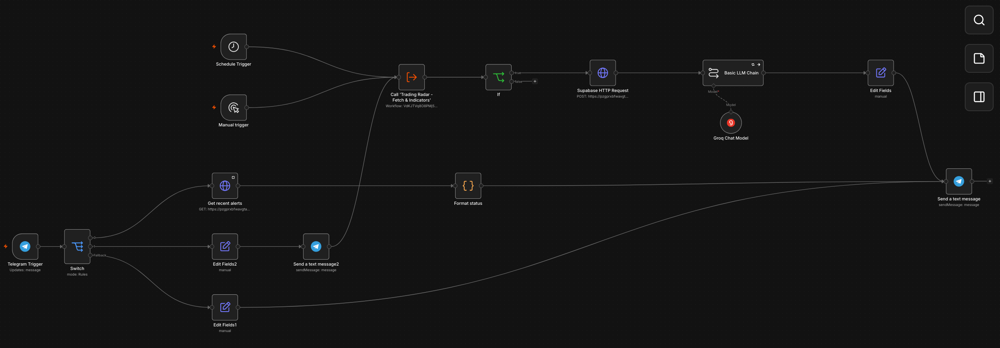
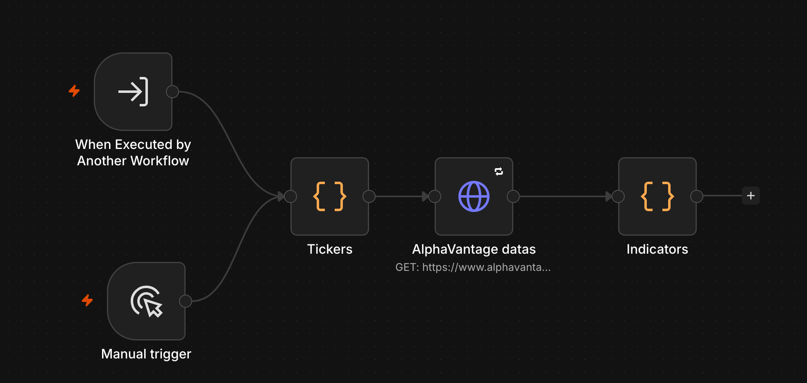
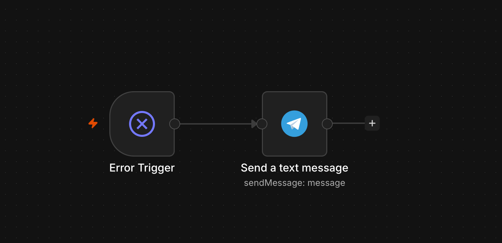
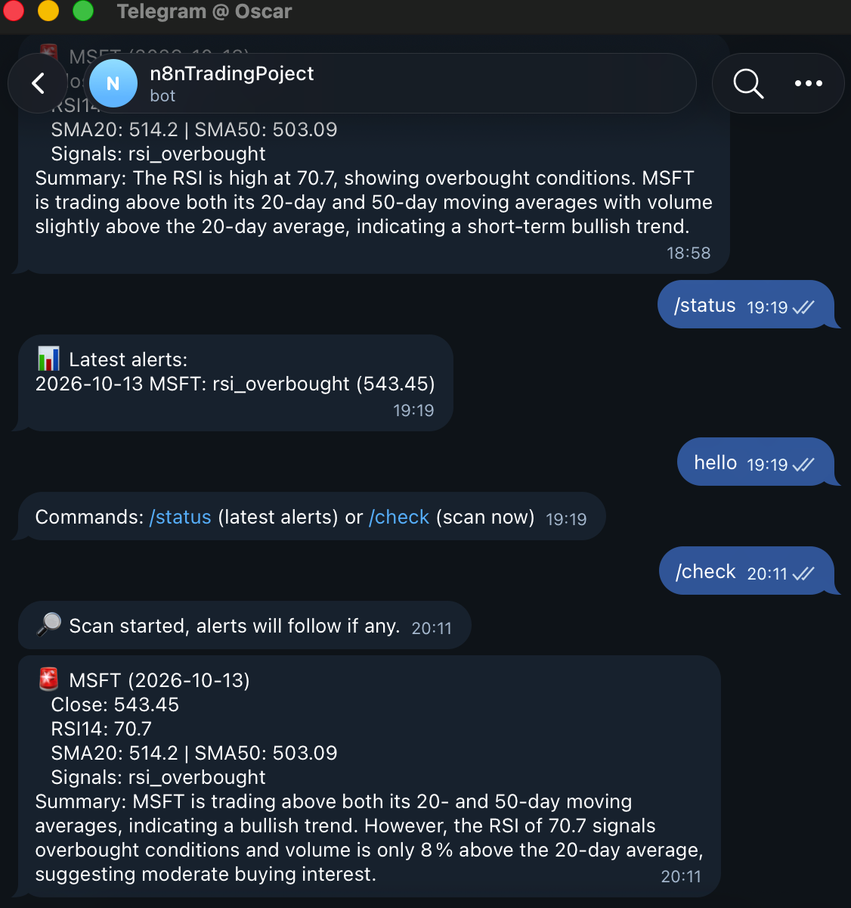

# Trading Signal Radar

Multi-criteria trading alerts built on **n8n**: it watches five US stocks and sends a **Telegram** alert, with an AI summary, when their technical indicators trigger a signal.

No-Code course project (3A) · Oscar Moulet · October 2026 · Target: **Level 3**

---

## Contents

1. [The need](#1-the-need)
2. [Overview](#2-overview)
3. [Architecture](#3-architecture)
4. [The three workflows](#4-the-three-workflows)
5. [Triggers](#5-triggers)
6. [Level and cut line](#6-level-and-cut-line)
7. [Requirements mapping](#7-requirements-mapping)
8. [Setup](#8-setup)
9. [Usage](#9-usage)
10. [Differences from the original proposal](#10-differences-from-the-original-proposal)
11. [Limits and operations](#11-limits-and-operations)
12. [Troubleshooting](#12-troubleshooting)
13. [Repository contents](#13-repository-contents)

---

## 1. The need

Data-focused financial analysts and trading enthusiasts need to track converging technical indicators across several assets. Today they spend hours refreshing charting software and logging price action into complex Excel models, and still risk missing entry points.

Trading Signal Radar automates this: each alert carries the key numbers and a two-sentence AI summary. A signal is sent **once per ticker, signal type and day**, so repeated runs stay quiet.

## 2. Overview

Watched tickers: **AAPL, MSFT, NVDA, SPCX, AMZN**.

| Part | Tool | Role |
| --- | --- | --- |
| Backend | n8n 2.x in Docker Compose | Triggers, routing, indicator logic |
| Market data | Alpha Vantage (`TIME_SERIES_DAILY`) | Daily prices and volume, free tier of 25 requests per day |
| Database | Supabase Postgres | `alerts` table for deduplication and `/status` |
| AI | Groq (`openai/gpt-oss-20b`) through a Basic LLM Chain | Two-sentence summary of each new alert |
| Messaging | Telegram bot | Alerts out, commands in |
| Public access | ngrok | HTTPS tunnel so Telegram can reach the local n8n |

## 3. Architecture

Rule followed: **boxes run, arrows move data**.

**Boxes**

- **Backend (n8n):** orchestration, loops, data transformations and indicator logic.
- **Database (Supabase Postgres):** stores the history of sent alerts, which enables deduplication.
- **External service 1, market data API (Alpha Vantage):** serves the raw prices.
- **External service 2, AI API (Groq):** turns the indicators into a readable summary.
- **External service 3, Telegram:** the chat channel where the deduplicated alerts arrive.
- **Tunnel (ngrok):** exposes the local n8n over HTTPS for the Telegram webhook.

**Arrows (direction of the request)**

| From | To | Content |
| --- | --- | --- |
| Telegram | Backend (through ngrok) | Webhook JSON with the command text and the `chat_id` |
| Backend | Alpha Vantage | HTTP GET of daily data for each ticker |
| Alpha Vantage | Backend | JSON of prices and volume |
| Backend | Supabase | Insert of the alert (ignored if already present); read of the last 5 for `/status` |
| Supabase | Backend | Inserted row (empty on a duplicate) or history rows |
| Backend | Groq | Prompt with the technical parameters |
| Groq | Backend | Text summary |
| Backend | Telegram | Final alert, status or help message |

Workflow diagrams:

| Workflow | Screenshot |
| --- | --- |
| Main |  |
| Fetch & Indicators |  |
| Error Handler |  |

The bot in conversation: 

In short: Telegram posts each message to the ngrok tunnel, which hands it to the Telegram Trigger in Main. Scheduled runs, manual runs and `/check` all call the same sub-workflow, which fetches prices from Alpha Vantage. Main then inserts the signal into Supabase (which filters out duplicates) and asks Groq for the summary. The Error Handler sits beside the other two and messages you on Telegram when one of them fails.

## 4. The three workflows

The project is split into a shared sub-workflow, a main workflow that owns every trigger, and an error handler. The JSON exports are in the repository.

### Trading Radar - Fetch & Indicators (sub-workflow)

Returns one item per ticker with its indicators. It starts from `When Executed by Another Workflow` (called by Main) or from a `Manual trigger` used for testing.

1. `Tickers` (Code) returns the five tickers.
2. `AlphaVantage datas` (HTTP Request) makes one daily-price call per ticker (`outputsize=compact`, about 100 candles). Batching is one item per request with a 1500 ms interval, **Retry On Fail** is on (2 tries, 2000 ms), and the key lives in a Query Auth credential.
3. `Indicators` (Code) computes SMA20, SMA50, RSI14 (Wilder), the volume ratio against the 20-day average and the list of signals. A ticker whose request failed returns an `error` field.

### Trading Radar - Main

Three entry points: `Schedule Trigger`, `Manual trigger` and `Telegram Trigger`.

**Scan path** (schedule, manual run and `/check`):

`Call 'Trading Radar - Fetch & Indicators'` → `If` (`signal_count` > 0) → `Supabase HTTP Request` → `Basic LLM Chain` (with `Groq Chat Model`) → `Output setup` (Set, builds the message) → `Send a text message`.

- True: at least one signal. The Supabase insert ignores duplicates and returns no row in that case, so the chain stops before Telegram.
- False: no signal. `Scan summary` (Code) prepares a message only if the scan came from `/check` (it checks that the Telegram Trigger ran), and `Send scan summary` sends it. This avoids silence when `/check` finds nothing, and also reports a reached Alpha Vantage quota.
- `Basic LLM Chain` has **Retry On Fail** (2000 ms) and **On Error: Continue**. If Groq fails, the alert is still sent with "Summary unavailable".

**Command path** (Telegram Trigger → `Switch` on the message text):

| Command | Branch | Result |
| --- | --- | --- |
| `/status` | `Get recent alerts` (GET, last 5 rows) → `Format status` (Code) → `Send a text message` | Latest alerts, with no Alpha Vantage request |
| `/check` | `Scan notification` (Set) → `Send a text message2` (acknowledgement) → scan path | Acknowledgement first, then alerts or a scan summary |
| `/help` or anything else | `Commands available` (Set) → `Send a text message` | Help text listing the two commands |

The acknowledgement and the scan are **chained** (not parallel) so that "Scan started" arrives before the alerts.

### Trading Radar - Error Handler

An `Error Trigger` feeds a Telegram node that sends the failed workflow's name, the last node run and the error message. It is attached through *Settings → Error Workflow* in both **Main** and **Fetch & Indicators**. It only runs for **published, automatic** executions (never for a run started from the editor).

## 5. Triggers

- **Schedule Trigger:** cron `0 17,23 * * 1-5`, Europe/Paris time zone. The 17:00 run happens mid-session in the US; the 23:00 run happens after the close, so it reads the finished daily candle.
- **Telegram Trigger:** fired by `/status`, `/check`, `/help` (or any other text). Restricted to a single chat ID so nobody else can send commands.
- **Manual trigger:** wired next to the schedule so the workflow can be fired on demand while building, because you cannot debug what you cannot repeat.

## 6. Level and cut line

The project targets **Level 3**: multi-criteria alerts, state tracking and deduplication.

Cut line planned in the proposal: if time ran out, the first cuts would be the AI summary and the database deduplication loop, falling back to a Level 2 workflow (fetch data, compute one indicator, send the alert without history). The error workflow and the sub-workflow would remain. **No cut was needed**: Level 3 is delivered in full.

## 7. Requirements mapping

| Requirement | Where it is met |
| --- | --- |
| If or Set node | `If` checks `signal_count` > 0; the Set nodes (`Output setup`, `Scan notification`, `Commands available`) build the Telegram text |
| Code node | `Tickers`, `Indicators` (SMA20, SMA50, RSI14, volume ratio, signals), `Format status`, `Scan summary` |
| Router or Switch | `Switch` on the Telegram message text: `/status`, `/check`, `/help`, fallback output |
| API or MCP connection | HTTP Request nodes for Alpha Vantage and the Supabase REST API, plus the Groq Chat Model |
| Message trigger | `Telegram Trigger`, reachable through the ngrok tunnel |
| Database for persistence | Supabase `alerts` table with a unique constraint on ticker, signal type and date |
| AI node | `Basic LLM Chain` with the Groq Chat Model |
| Sub-workflow | Fetch & Indicators, called from Main by an Execute Workflow node and reused by the schedule, manual runs and `/check` |
| Error handling and retries | Error Handler workflow; Retry On Fail on the Alpha Vantage request and the LLM chain (with On Error: Continue) |

## 8. Setup

You need Docker Desktop and free accounts at Telegram (BotFather), Alpha Vantage, Supabase, Groq and ngrok.

### 8.1 Supabase table

Create a project, open the SQL Editor and run:

```sql
create table alerts (
  id bigint generated always as identity primary key,
  ticker text not null,
  signal_type text not null,
  signal_date date not null,
  price numeric,
  summary text,
  created_at timestamptz default now(),
  unique (ticker, signal_type, signal_date)
);
```

The `unique` constraint is the deduplication. n8n talks to the table through the Supabase REST API (`/rest/v1/alerts`) over HTTPS, with the secret key stored in a Header Auth credential named `apikey`.

> The native Postgres node failed with "Connection terminated unexpectedly" from a home network (Supabase pooler), so the REST API was used instead.

### 8.2 n8n and the tunnel in Docker Compose

n8n runs from `compose.yml` with its task runners and sandbox services. Two changes make Telegram reachable: in the `n8n` service, a `restart` policy and an `environment` block (public URL, time zone, proxy setting); then an `ngrok` service that forwards your free ngrok domain to n8n.

```yaml
  n8n:
    restart: unless-stopped
    env_file: .env
    environment:
      WEBHOOK_URL: https://YOUR-DOMAIN.ngrok-free.dev
      GENERIC_TIMEZONE: Europe/Paris
      TZ: Europe/Paris
      N8N_PROXY_HOPS: '1'

  ngrok:
    image: ngrok/ngrok:latest
    restart: unless-stopped
    command: http --url=YOUR-DOMAIN.ngrok-free.dev n8n:5678
    environment:
      NGROK_AUTHTOKEN: ${NGROK_AUTHTOKEN}
    ports:
      - '4040:4040'
    depends_on:
      - n8n
```

Put `NGROK_AUTHTOKEN=your_token` in the `.env` file next to `compose.yml`, then run `docker compose up -d`.

> Never run `docker compose down -v`: the `-v` flag deletes the volume that holds your workflows and credentials.

The editor stays at http://localhost:5678 and ngrok's inspector is at http://localhost:4040.

### 8.3 Credentials in n8n

| Credential | Type | Used by |
| --- | --- | --- |
| Telegram account | Telegram API (bot token from BotFather) | Telegram Trigger and the send nodes |
| Alpha Vantage key | Query Auth, name `apikey` | `AlphaVantage datas` (sub-workflow) |
| Supabase key | Header Auth, name `apikey` | `Supabase HTTP Request` and `Get recent alerts` |
| Groq account | Groq API key | Groq Chat Model |

Keep every key in a credential, never in a node parameter, so the workflows can be exported safely.

### 8.4 Workflows

1. Import (or build) **Fetch & Indicators** and publish it.
2. Import **Error Handler** (Error Trigger, then a Telegram node) and publish it.
3. In Main and in Fetch & Indicators, open *Settings* and select Error Handler under *Error Workflow*.
4. In Main, set the time zone to Europe/Paris, set the Schedule Trigger to the cron `0 17,23 * * 1-5`, and in the Telegram Trigger use *Additional Fields → Restrict to Chat IDs* with your own chat ID.
5. Publish **Main**.

After importing, reconnect the credentials and replace the project-specific values (Supabase URL, chat ID) with your own.

## 9. Usage

### Commands

| Message to the bot | Reply |
| --- | --- |
| `/status` | The five latest alerts from the database; no Alpha Vantage request |
| `/check` | An acknowledgement, then a scan now (5 Alpha Vantage requests); alerts follow, or a scan summary if there are none |
| Anything else (including `/help`) | A help line listing the commands |

### Signals

| Signal | Condition |
| --- | --- |
| `golden_cross` | SMA20 crosses above SMA50 on the latest candle |
| `death_cross` | SMA20 crosses below SMA50 on the latest candle |
| `rsi_overbought` | RSI14 above 70 |
| `rsi_oversold` | RSI14 below 30 |
| `volume_spike` | Latest volume above 1.5 times the 20-day average |

### Alert format

A real alert from the first live run:

```
🚨 MSFT (2026-10-13)
Close: 543.45
RSI14: 70.7
SMA20: 514.2 | SMA50: 503.09
Signals: rsi_overbought
Summary: The RSI is high at 70.7, showing overbought conditions. MSFT is trading above both its 20-day and 50-day moving averages with volume slightly above the 20-day average, indicating a short-term bullish trend.
```

### Deduplication

Before a message is built, the workflow inserts the signal into the `alerts` table (`on_conflict=ticker,signal_type,signal_date` with `Prefer: resolution=ignore-duplicates,return=representation`). If the row already exists, the insert is ignored, returns nothing, and the chain stops: no AI summary and no message. The guarantee comes from the `unique` constraint in the database, not from the workflow.

To replay an alert while testing, delete its row in the Supabase Table Editor.

## 10. Differences from the original proposal

| Proposal | Built | Reason |
| --- | --- | --- |
| Schedule every ~15 minutes | 2 runs per day (17:00 and 23:00, weekdays) | Alpha Vantage free quota: 25 requests per day, 5 per scan |
| `/alert` command | `/check` command | Clearer: it runs a scan immediately |
| No tunnel | ngrok service added | The Telegram webhook needs a public HTTPS URL to a local n8n |
| Postgres + "SQL Insert" | Supabase REST API with an insert that ignores duplicates | The Postgres node failed from a home network |
| AI "Groq or OpenAI" | Groq, model `openai/gpt-oss-20b` | Free and fast; a Prompt Guard model (a classifier) returned a number instead of text |
| Read history before sending | Insert that ignores duplicates | One request does the read and the write, atomically |
| No scan summary | `Scan summary` for `/check` | Avoid silence when there is no signal or the quota is reached |

## 11. Limits and operations

- **Alpha Vantage quota:** 25 requests per day on the free tier. A scan costs 5, so two scheduled runs use 10 and each `/check` uses 5, leaving room for about 3 manual checks a day. The quota resets daily.
- **Laptop and Docker:** the Mac must be awake at 17:00 and 23:00, or that run is skipped. Docker Desktop starts at login and the containers use `restart: unless-stopped`, so n8n and ngrok come back after a reboot.
- **Tunnel domain:** `WEBHOOK_URL` in `compose.yml` must match the ngrok domain exactly, including the ending and with no trailing `/`. Inspect Telegram's requests at http://localhost:4040.
- **Free Supabase:** the project pauses after about a week of inactivity; requests then fail (the Error Handler warns you) until you click *Restore project*.
- **Editor tests versus production:** clicking *Execute step* on the Telegram Trigger replaces the production webhook with a test one, so commands stop answering. Unpublish and publish Main again to restore it. Editor runs also use pinned data when a node is pinned.
- **Error Handler:** it only fires for published, automatic executions.
- **SPCX:** it listed in June 2026, so it has fewer than 100 days of history. That is enough for SMA20, SMA50 and RSI14, but not for a 200-day average.
- **Not advice:** the summary prompt forbids financial advice and price predictions; the alerts are indicator readings, not recommendations.

## 12. Troubleshooting

Problems met while building the project and how each was fixed.

| Symptom | Cause | Fix |
| --- | --- | --- |
| Alpha Vantage returns "Invalid API call" | A required parameter (`symbol`, `apikey`) is missing or misspelled | Rebuild the node with *Import cURL* |
| `Indicators` returns ticker UNKNOWN with a rate-limit message | The 25 requests per day quota is used up | Wait for the daily reset; pin data or scan one ticker while testing |
| Postgres node: "Connection terminated unexpectedly" | The Supabase pooler drops the connection from a home network | Use the Supabase REST API with an HTTP Request node |
| `getUpdates` returns an empty result | The bot has received no message yet | Send `/start` and a message to your own bot first |
| Telegram Trigger: "Failed to resolve host" | Wrong domain ending in `WEBHOOK_URL` (`.de` instead of `.dev`) | Copy the domain exactly from ngrok, then run `docker compose up -d` |
| The summary is a number such as 0.0017 | A Prompt Guard model (a safety classifier) was selected | Choose a text model such as `openai/gpt-oss-20b` |
| The message shows `rsioverbought` | Markdown parse mode swallows underscores | Set Parse Mode to HTML on the Telegram node |
| Everything goes to the false branch of `If` | The RSI test threshold of 65 was set back to 70 | Expected; use 65 only for tests |
| Commands stop answering after an editor test | The test webhook replaced the production one | Unpublish and publish Main |
| The alert arrives before "Scan started" | The two `/check` branches ran in parallel | Chain them: acknowledgement, then the scan |
| `/status` replies "Workflow failed" | The Supabase project is paused | *Restore project* in Supabase |
| No message on a rerun | Deduplication is working | Delete the row in Supabase to replay the alert |

## 13. Repository contents

```
n8n_nocode_project/
├── README.md                          This document
├── compose.yml                        n8n, task runners, sandbox, ngrok
├── telegram_bot.png                   Screenshot of the Telegram bot
├── Main_workflow/
│   ├── Trading Radar - Main.json      Export of the main workflow
│   └── main_workflow.png
├── Fetch_Indicators/
│   ├── Fetch & Indicators.json        Export of the sub-workflow
│   └── Fetch_Indicators_workflow.png
└── Error_Handler/
    ├── Error Handler.json             Export of the error handler
    └── error_handler.png
```

The JSON exports contain no API keys: only credential names appear in them.
